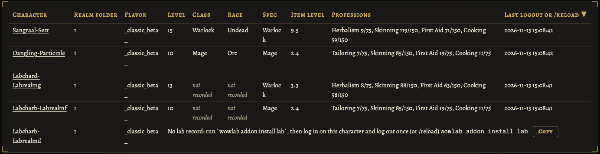
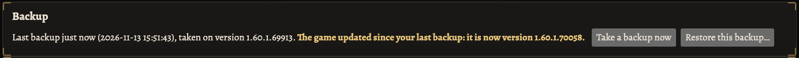
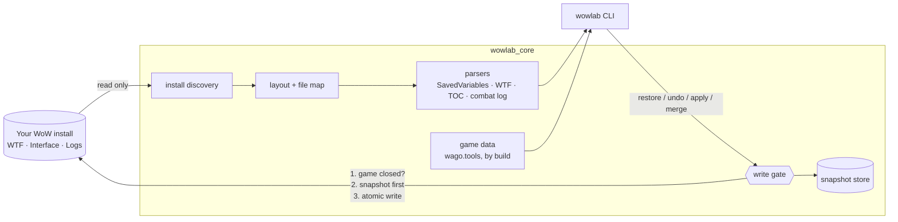

<p align="center">
  <a href="https://github.com/sandgraal/wowlab/actions/workflows/ci.yml"></a>
  
  
  <a href="https://github.com/sandgraal/wowlab/releases/tag/v0.1.0"></a>
  <a href="LICENSE"></a>
</p>

<h3 align="center">Every character you have played on this computer in one place, and a UI you can put back.</h3>

<p align="center">
  <a href="#-what-it-does">What it does</a> ·
  <a href="#-the-safety-promises">Safety promises</a> ·
  <a href="#-running-it-from-source">Run it from source</a> ·
  <a href="https://github.com/sandgraal/wowlab/wiki">The wiki</a> ·
  <a href="https://github.com/sandgraal/wowlab/wiki/Roadmap">What's next</a>
</p>

**wowlab** is a free companion for World of Warcraft that runs on your own computer. It reads your game folder, never the game itself.

🧙 **All your characters in one place.** 🆕 `wowlab ui` opens on the Account tab: every character you have played on this computer, in every game version you have installed, as of its last logout, with level, class, race, spec, item level and professions. Sort by any column, filter by class, and click a character for its gear, keys, macros and history. Race, spec and profession names come from the game's own tables, which wowlab downloads from wago.tools only when you ask: run `wowlab db2 fetch ChrRaces`, `wowlab db2 fetch ChrSpecialization` and `wowlab db2 fetch SkillLine` once for each game version. Until then they show as numbers.

<p align="center"></p>

🛟 **A UI you can put back.** 🆕 **Take a backup now**, at the top of the same tab, saves your settings, keybinds, macros, addons and their saved settings into wowlab's own folder, never your game folder. After a patch the tab tells you the game updated since your last backup, and **Restore this backup…** opens the restore, where you see what putting it back would change before anything changes.

<p align="center"></p>

<p align="center"><sub>Both pictures are of a test copy of a Forever install.</sub></p>

The same backup from the command line is `wowlab snap create`. Take one before patch day or an addon update; afterwards, take another and `wowlab snap diff` shows what changed between them, and `wowlab snap restore` puts the files back. `wowlab undo` reverses wowlab's own last change. And:

- 📈 **Each character over time.** 🆕 `wowlab char history` reads your snapshots back, one row per snapshot you took: level, item level and spec, and the gear and currencies that changed.
- 🧩 **A patch-day check.** 🆕 `wowlab addons check` lists every addon against your game version: out of date, missing an addon it needs, and which characters have it turned on. The Account tab's Patch day card lists the addons with a problem, counts the ones that are current, and lists the saved data that no installed addon claims or that wowlab cannot read.
- 🎹 **A keybind coach.** `wowlab binds coach` reads your own combat log and shows the spells you cast most on awkward keys. It needs combat logging turned on in the game and the lab-addon's record of your action bars.

Level, class, gear and the rest appear once wowlab's small in-game addon has recorded them: run `wowlab addon install lab`, then log out or `/reload` once. Action bars and talents are kept on Blizzard's servers, not in your game folder, so a snapshot cannot put those back, and a bar button that holds a macro runs whichever macro is now at that place in your macro list.

> [!NOTE]
> The install line below installs v0.1.0, which has snapshots and undo, the file explorer and the keybind coach. Everything marked 🆕 on this page (the Account, Character and Looks tabs, `char history`, `char list --summary`, `addons check` and more) is on `main` and arrives with the next release, together with a Mac app for Apple silicon ([the install guide](docs/INSTALL.md#the-mac-app-apple-silicon-no-terminal-needed)) and a Windows app, which nobody has yet tried on a real Windows install ([the install guide](docs/INSTALL.md#the-windows-app-64-bit-no-terminal-needed)). To try them now, [run it from source](#-running-it-from-source). In v0.1.0, `wowlab doctor` also asks wago.tools whether your game version is listed; add `--offline` to skip that.

**📦 Install** (you need [uv](https://docs.astral.sh/uv/); it brings Python 3.12):

<!-- not-run: an install, from the network -->
```bash
uv tool install --python 3.12 https://github.com/sandgraal/wowlab/releases/download/v0.1.0/wowlab_core-0.1.0-py3-none-any.whl#sha256=a3c3bd86f98600f26db4cb10f69486cca7e1a62d032d0fe35b09c53fcc9be639
```

The `#sha256=` part is the download's fingerprint, the same as its line in the release's `SHA256SUMS`. `uv tool install` does not check it for you: [the install guide](docs/INSTALL.md) shows how to check the download and install that very file, and what to do when your game is not in the usual place.

**⚔️ The first three commands:**

<!-- not-run: `wowlab ui` does not exit -->
```bash
wowlab doctor        # finds your install; on a first run, says what wowlab will do and offers a first snapshot
wowlab ui            # the browser view; every character in one place arrives with the next release
wowlab snap create   # back up your setup before patch day or an addon update
```

**🛡️ What it will and will not do:**

- **Read-only by default.** Looking at your install never writes to it: no temp, cache or lock file.
- **Every command that changes files in your install asks first** (unless you pass `--yes`), refuses while the game is running, and goes through one write gate that takes a snapshot before it writes. `wowlab undo` reverses the change.
- **It never touches the game itself:** no game memory, no `Data/` or program files, no key presses. Addon data is read as data, never run.

<!-- network:begin -->
**What leaves your machine. Nothing is uploaded: these three are wowlab's only network traffic, and no other command makes a request.**

- `wowlab doctor --check-builds` downloads the public list of game versions from wago.tools, a community-run public site of game data, and looks for your installed versions in it; nothing from your install is sent. Without `--check-builds`, `doctor` makes no network request.
- `wowlab db2` and `wowlab looks` download public game data from wago.tools: its list of game versions, and tables for one version at a time. A table request names that version: your installed one, or the one you give with `--build`.
- A dressing-room link opens in your own browser, and only when you click it, carrying your character's race, body type, class, level and equipped item and bonus ids to that site: public game ids only, never a name. wowlab itself makes no request to it.
<!-- network:end -->

**🖥️ `wowlab ui`** opens your browser on a page only this computer can reach, and keeps working until you stop it with Ctrl-C. If no browser opens, paste the link it prints. When your game is not in the usual place, set `WOWLAB_WOW_ROOT` first ([the install guide](docs/INSTALL.md) shows how).

- 🏰 **Account** 🆕, the home tab: every character, sortable and filterable (the first picture above). A character with nothing recorded yet says how to fix that. Above the characters, the **Backup** line (the second picture) and the **Patch day** card.
- 🧙 **Character** 🆕: one character's gear with item-quality colours, every key and what it does, every macro with the checker's findings, its **History** from your snapshots, and a **See it dressed** link.
- 🎨 **Looks** 🆕: every race's customization options and your saved looks, the same page `wowlab looks page` makes.
- 🗂️ **Explorer** and **Gaps**: every file in your install, what it is, who writes it and whether it is safe to touch, and the files wowlab does not know yet.
- ⌨️ **Commands**: run any wowlab command from the page. One that changes files shows its plan first and runs only when you press **Confirm** 🆕.

`wowlab ui` changes game files only when you confirm a plan it showed you.

<details>
<summary><b>Exactly what the browser view runs, and one note for shared machines</b></summary>

&nbsp;

It runs every wowlab command except `ui` itself, `log tail --follow`, `looks page --out` and `snap export`. The commands that read, and the ones that save only to wowlab's own data (snapshots, profiles, saved looks, the game-table cache, pages), run directly. A command that asks before changing anything (`--yes`) runs first as a plan that changes nothing, and runs for real only when you confirm the plan it shows: `snap gc` and `doctor --yes` change only wowlab's own store, and `snap restore`, `undo`, `profile apply`, `sv merge`, `addon install` and `addon remove` change your install through the same write gate as on the command line, which takes a snapshot first, so `wowlab undo` reverses them. Two of them refuse when something changed after the plan: `undo`, when a newer change has been recorded, and `sv merge`, when its target file or what it merges from changed. The others apply what is there when you confirm. It listens only on this machine. The link it opens, a reload of the page and a second tab keep working until you stop `wowlab ui` with Ctrl-C; a new `wowlab ui` makes a new link, and the old one stops working. It is made for a single-user machine. **On a shared Linux machine**, other accounts can see that link in their process listing for a while (a newly started browser can keep it in its command line), and can open it too, until you stop `wowlab ui`. From the page, `sv dump` reads only files inside your install.

</details>

**🗺️ Platforms:**

| | Status |
|---|---|
| macOS | **Supported.** CI runs the test suite on macOS, and [a first run on a real Mac install is recorded](docs/handoffs/M13-10-macos.md). |
| Windows | **Untested.** CI runs the test suite on Windows, but nobody has yet run the first-run flow on a real Windows install. |
| Linux | **Untested.** CI runs the test suite on Linux, but there is no native Linux client (Wine or Proton) and nobody has run wowlab against one. |

wowlab is built and tested on Forever on macOS; retail and Windows SavedVariables are untested.

**📖 The guide:** [the wiki](https://github.com/sandgraal/wowlab/wiki) has a page for every command, the safety rules in plain words and the first run step by step.

<!-- The first screen ends here (M13-10; tests/scripts/test_readme.py). -->

---

## 🤔 Why you might want it

| You're thinking… | wowlab's answer |
|---|---|
| **"I have alts everywhere and lose track of them."** | The 🆕 Account tab lists every character you have played on this computer in one table, as of its last logout: level, class, spec, item level, professions, and when you last logged out on it. |
| **"Patch day broke my UI."** | Take a snapshot before patch day or an addon update. If something goes wrong, take another and `wowlab snap diff` shows what changed, `wowlab snap restore` puts the files back (files added since are left alone), and 🆕 `wowlab addons check` shows which addons are out of date. |
| **"What is `config-cache.wtf`, and is it safe to change?"** | `wowlab explain config-cache.wtf` answers that for any file in your install: what it is, who writes it, when, and whether editing it is safe. 🆕 A bare file name is enough: it finds every file by that name. |
| **"My addon settings are a mess."** | Read any addon's saved settings as plain text, with nothing executed and nothing changed. Merge one addon's settings between characters without touching the rest. |
| **"I play on the Forever beta and nothing is documented."** | wowlab was built against a real Forever install: its folder layout, file formats and combat log are written up in plain words. |
| **"My macros and keybinds grew over years."** | `wowlab macros check` finds broken spell names, overlong and duplicate macros, and macros on no action bar. `wowlab binds coach` reads your own combat log and shows the spells you cast most on awkward keys. |
| **"I want to see my character without logging in."** | The lab-addon records your gear, talents and more at logout. `wowlab char show` and the 🆕 Character tab read it back offline, and 🆕 `wowlab char history` shows how it changed from one snapshot to the next. |

## ✨ What it does

Features marked 🆕 are on `main` and arrive with the next release.

### 🔍 Understand your install

| | Feature | Command |
|---|---|---|
| 🔍 | **Explain any file.** Every path in your install mapped: what it is, who writes it, when, and whether wowlab may edit it. | `wowlab explain PATH` · `wowlab tree --explain` |
| 🖥️ | **The explorer in your browser.** A local page, served only to this machine, that shows every file in your install with whether each is safe to touch. It also runs wowlab's commands, and a command that changes files gets a plan-then-Confirm step 🆕. Exactly which commands, and how that step works, is spelled out under **`wowlab ui`**, near the top of this page. | `wowlab ui` |
| 🩺 | **Health check and first run.** Finds your install, its flavors and versions, whether the game is running, and your server-sync settings. On a first run it says what wowlab will and won't do and offers a first snapshot. `--redact` prints output safe to paste into an issue. | `wowlab doctor` · `wowlab doctor --redact` |
| 🧩 | **Patch-day check** 🆕. Every addon against your game version: out of date, missing an addon it needs, loaded on demand, and which characters have it turned on. | `wowlab addons check` |
| 📜 | **Read your saved data.** Addon SavedVariables, CVars, keybinds, macros and your addon list, as readable text or JSON. | `wowlab sv dump` · `cvar` · `binds` · `macros` · `addons` |
| 📚 | **Game data.** Any game table for your exact build, from [wago.tools](https://wago.tools), cached forever and keyed by build. | `wowlab db2 fetch TABLE` |
| ⚔️ | **Combat log.** A streaming combat-log reader and a live `tail` that follows the game as it writes, even across new log files. | `wowlab log tail --follow` |

### 🛟 Change things without fear

| | Feature | Command |
|---|---|---|
| 📸 | **Snapshots.** Save your whole setup (settings, keybinds, macros, addons and their saved data) and compare any two snapshots, down to the individual addon setting. | `wowlab snap create` · `snap diff A B` |
| ↩️ | **Undo, for real.** Put a snapshot back, or undo the last change. You see the plan first, and it refuses while the game is running. Putting a whole snapshot back never deletes files added since it was taken; the plan lists them as left alone. | `wowlab snap restore` · `wowlab undo` |
| 🏷️ | **After the launch rename** 🆕. When a beta launches, the game's folder gets a new name. Log in once on the launched game, then put a snapshot or a profile into the new folder, or into another install folder, on this computer or, after `snap export` and `snap import`, on another: you name the target, and the plan shows both folders and which account folder goes where. Character settings go to the same realm and character only. | `snap restore <id> --into-flavor <folder>` · `--into-root <path>` · `snap export <id> <file>` · `snap import <file>` · `profile apply <name> --into-flavor <folder>` |
| 🎛️ | **Profiles.** Save named UI setups (`raid`, `clean`, `gamepad`) and switch between them with one command. You see the plan first, applying one also deletes files created since it was saved, and `wowlab undo` reverses it. On the Forever launch client (tested 2026-11-12), settings and a character's own key bindings and macros put back this way survived the next login; account-wide key bindings are not yet confirmed. Action bars and talents are kept by the server, but a bar button holding a macro runs whichever macro is now at that place in your list, so adding or removing macros can change what it does. | `wowlab profile save` · `profile apply` |
| 🔀 | **Merge addon settings.** Copy one addon's settings between characters, or from a snapshot, without clobbering the rest. Conflicts are listed and never guessed, and it first checks that the client has been loading saved data correctly. | `wowlab sv merge` |

### 🧙 Your characters and your keys

| | Feature | Command |
|---|---|---|
| 🧩 | **The lab-addon.** wowlab's own small in-game addon records a character's gear, talents, customization, collections, currencies and professions (never a name) when you log out or `/reload`, and wowlab reads them back offline. | `wowlab addon install lab` · `wowlab char show` |
| 🏰 | **The Account tab** 🆕. The home tab of the browser view: every character you have played on this computer, in every game version you have installed, as of its last logout, with level, class, race, spec, item level, professions and when you last logged out on it. Sort by any column, filter by game version or class, and click a character to open it. Also on the command line. | `wowlab ui` · `wowlab char list --summary` |
| 📈 | **A character over time** 🆕. One row per snapshot you took: level, item level and spec, and the gear and currencies that changed since the one before. | `wowlab char history` |
| 🧙 | **The Character tab** 🆕. Pick a character in the browser view and see its gear with item-quality colours, every key and what it does, and every macro with the checker's findings, and a **See it dressed** link that opens an outside dressing room in your own browser. Read-only: it never changes a file. | `wowlab ui` |
| 🎒 | **Gear, keys and macros from the command line** 🆕. The same three views as text or JSON. | `wowlab char gear` · `char binds` · `char macros` |
| 🧹 | **Macro checker.** Broken spell names, overlong and duplicate macros, macros on no action bar. | `wowlab macros check` |
| 🎹 | **Keybind coach.** From your own combat log: spells cast often on awkward keys, spells cast with no bind, and binds never used. Read-only, with an editable "awkward key" table. It needs combat logging turned on in the game and the lab-addon's record of your action bars. | `wowlab binds coach` |
| 🎨 | **Customization looks.** Browse every race's customization options from the game's own tables, save and compare looks, import one from a character, and open it all as a local web page (inside the browser view too 🆕). Data only: it never touches the game. | `wowlab looks races` · `save` · `compare` · `page` |

<details>
<summary><b>See it in action</b> (output from a test copy of a Forever install; `…` marks what is left out)</summary>

```text
$ wowlab explain WTF/Account/<ACCOUNT>/SavedVariables/DBM-Party-Vanilla.lua
WTF/Account/<ACCOUNT>/SavedVariables/DBM-Party-Vanilla.lua (in flavor folder _classic_beta_)
  what:         An addon's saved data for the whole account
  written by:   The game, on logout or `/reload`
  edit:         yes, through wowlab's write gate only, with the client closed
  file-map row: account-savedvariables
…

$ wowlab sv dump SavedVariables/DBM-StatusBarTimers.lua
DBT_AllPersistentOptions["Default"]["DBM"]["HugeBorderColorG"] = 0
DBT_AllPersistentOptions["Default"]["DBM"]["HugeBarsEnabled"] = true
DBT_AllPersistentOptions["Default"]["DBM"]["TimerY"] = -260
…

$ wowlab doctor
First run: wowlab has no snapshot of this install yet. What it will and will not do:
…
Install: /path/to/World of Warcraft (found by a default location)
Flavor _classic_beta_: product wow_classic_beta, version 1.60.1.69913
  Game data: not checked (--check-builds asks wago.tools)
…
Client: not running
wowlab: version …, …
Snapshot store: … (not created yet)
…
```

</details>

## 🛡️ The safety promises

> [!IMPORTANT]
> These are hard rules in the code, checked by tests on every change, not intentions.

| | Promise | What it means |
|---|---|---|
| 👀 | **Reading never writes.** | Looking at your install changes nothing: no temp files, caches or lock files inside it. |
| 🚪 | **One door for every change.** | Anything wowlab writes goes through a single *write gate*. The gate refuses while the game is running, takes a snapshot first, records what it did, and replaces files atomically. There is no "force" switch that skips any of that. |
| 🚫 | **No Lua is ever run.** | Addon data is read as data by a strict parser. Functions or code in a saved file are refused, never executed. |
| 🧱 | **Nothing is lost.** | The parsers keep every byte they don't understand. An unedited file comes back byte for byte. |
| 🏠 | **Stays on your machine.** | No accounts, no server, no uploads. Everything wowlab sends over the network is listed once, under "What leaves your machine" at the top. |
| ⛔ | **Clearly out of bounds, permanently.** | No memory reading, no injection, no packet tampering, no input automation, no touching game `Data/` or executables, no bypassing integrity checks. wowlab only changes what the game itself treats as your settings. |

## 🧭 What's next

wowlab grows one step at a time, and each step is picked after the last one ships. What is planned, and the longer list of ideas behind it, is on [the wiki's Roadmap page](https://github.com/sandgraal/wowlab/wiki/Roadmap). Nothing there is promised until it is on `main`.

## 🚀 Running it from source

> [!NOTE]
> Players install a release with the one `uv tool install` line at the top of this page. Running from source is for trying `main` or working on wowlab. There is no hosted version, and nothing is uploaded either way.

You need [uv](https://docs.astral.sh/uv/) (it brings Python 3.12) and git.

<!-- not-run: a source checkout, from the network -->
```bash
git clone https://github.com/sandgraal/wowlab && cd wowlab
uv sync --frozen
uv run wowlab doctor        # finds your install and checks everything
uv run wowlab --help        # every command
```

Every `wowlab …` command on this page and on the wiki works the same from a checkout: put `uv run` in front of it. Set `WOWLAB_WOW_ROOT` if your install is not in a default location ([the install guide](docs/INSTALL.md)). To work on wowlab itself (the tests, the developer commands, machine setup), see [`CONTRIBUTING.md`](CONTRIBUTING.md).

> [!TIP]
> Exit codes: `0` ok, `1` error (and `explain` of a path that matches nothing), `2` usage, `3` refused by the write gate. Only these six commands change your install: `snap restore`, `undo`, `profile apply`, `sv merge` and `addon install` / `addon remove`. Every one goes through the write gate and shows the plan and asks first unless you pass `--yes`; most of them also take `--dry-run`.

## ⚙️ How it works



Flavor folders, product codes and build numbers are **discovered from your install**, never hard-coded, so wowlab works the same on retail and on *World of Warcraft: Forever*. The details: [`docs/LAB_PLAN.md`](docs/LAB_PLAN.md) (the spec), [`docs/LAB_FILE_MAP.md`](docs/LAB_FILE_MAP.md) (every path) and [`docs/LAB_FORMATS.md`](docs/LAB_FORMATS.md) (every file format).

## 🏗️ How it's built

wowlab is written by Claude Code agents coordinated by a *conductor* session, while the owner makes every decision and captures the real test files from the game. Each change is a small ticket with checkable acceptance criteria. Every branch gets an independent code review, plus security and WoW-accuracy reviews wherever they apply. The files that rewrite your data (the SavedVariables parser and the write gate) get their tests written first by a different agent than the one that writes the code. Test files are real captures from the game, scrubbed of names and identifiers before they are committed. Details: [`docs/AGENT_WORKFLOW.md`](docs/AGENT_WORKFLOW.md) and [`AGENTS.md`](AGENTS.md).

```
lab/core/   wowlab (imported as wowlab_core): the library and the wowlab CLI (later apps: lab/<app>/)
scripts/    repository tooling, including the fixture capture and scrub tool
tests/      tests for the agent harness hooks
docs/       spec, formats, file map, ideas, decisions, backlog, glossary, workflow
.claude/    agent definitions, skills, path rules, guard hooks
```

## 📖 Documents

| Document | What it holds |
|---|---|
| [The wiki](https://github.com/sandgraal/wowlab/wiki) | Guides for every command, the safety rules in plain words, a command reference, notes on the Forever beta, a glossary and the roadmap. |
| [`docs/LAB_PLAN.md`](docs/LAB_PLAN.md) | The spec: purpose, architecture, every module, testing, how waves work, the Wave 2 to 5 plans. |
| [`docs/LAB_FILE_MAP.md`](docs/LAB_FILE_MAP.md) | Every path in an install: what it is, who writes it, whether it is safe to edit. |
| [`docs/LAB_FORMATS.md`](docs/LAB_FORMATS.md) | The client file formats, with what real Forever captures showed. |
| [`docs/LAB_IDEAS.md`](docs/LAB_IDEAS.md) | The menu for later waves. |
| [`docs/GLOSSARY.md`](docs/GLOSSARY.md) | WoW and client terms, several of them misleading. |
| [`docs/DATA_SOURCES.md`](docs/DATA_SOURCES.md) | The install, wago.tools, and a log of every surprise. |
| [`docs/DECISIONS.md`](docs/DECISIONS.md) | Architecture decisions (ADRs). |
| [`docs/BACKLOG.md`](docs/BACKLOG.md) | The current wave's tickets. |
| [`docs/handoffs/`](docs/handoffs/) | Capture runbooks and wave reviews. |
| [`AGENTS.md`](AGENTS.md) | The constitution: the hard rules above, in full. |
| [`docs/AGENT_WORKFLOW.md`](docs/AGENT_WORKFLOW.md) · [`docs/SETUP.md`](docs/SETUP.md) | How work moves; machine setup. |

## License and affiliation

[Apache-2.0](LICENSE). The page `wowlab ui` serves sets its type in fonts that ship inside the package unchanged, under the SIL Open Font License 1.1, whose two texts sit beside the font files: Alegreya and Alegreya SC (Copyright 2011 The Alegreya Project Authors; [`OFL-Alegreya.txt`](lab/core/src/wowlab_core/ui/templates/fonts/OFL-Alegreya.txt)) and IBM Plex Mono (Copyright 2017 IBM Corp.; [`OFL-IBMPlexMono.txt`](lab/core/src/wowlab_core/ui/templates/fonts/OFL-IBMPlexMono.txt)). World of Warcraft and Blizzard Entertainment are trademarks of Blizzard Entertainment, Inc. wowlab is an independent project, not affiliated with or endorsed by Blizzard. No game assets or Blizzard code are committed here. Security and privacy reports: [`SECURITY.md`](SECURITY.md). This repository previously held a different project, retired on 2026-09-21 (ADR-0025, git tag `bronze-final`).
