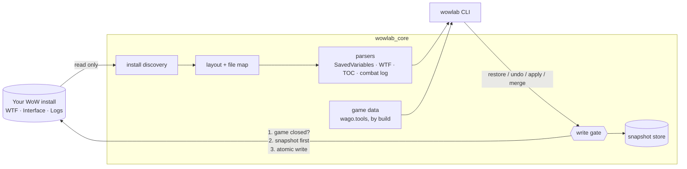
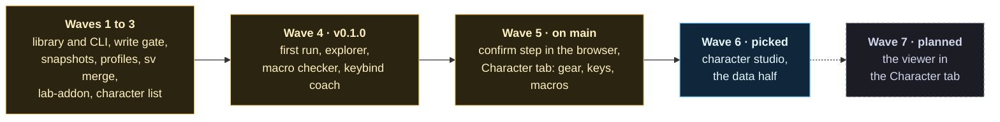

<p align="center">
  <a href="https://github.com/sandgraal/wowlab/actions/workflows/ci.yml"></a>
  
  
  <a href="https://github.com/sandgraal/wowlab/releases/tag/v0.1.0"></a>
  <a href="LICENSE"></a>
</p>

<h3 align="center">Ever wondered what all those files in your WoW folder actually are?</h3>

<p align="center">
  <a href="#-what-it-does-today">What it does</a> ·
  <a href="#-the-safety-promises">Safety promises</a> ·
  <a href="#-where-it-is-now">Where it is now</a> ·
  <a href="#-whats-planned-next">What's next</a> ·
  <a href="#-the-full-vision">The full vision</a> ·
  <a href="https://github.com/sandgraal/wowlab/wiki">The wiki</a>
</p>

**wowlab** reads your World of Warcraft install and tells you what every file in it is, who writes it, and whether it is safe to touch. It snapshots your whole setup (settings, keybinds, macros, addons and their saved data), lets you switch UI profiles or merge addon settings, and puts everything back with `wowlab undo`. It is a command-line tool with a local browser view, and it runs only on your own machine, against your own install.

> **Your WoW folder, finally explained, and every change undoable.**

**🛡️ What it will and will not do** ([ADR-0031](docs/DECISIONS.md)):

- **Read-only by default.** Looking at your install never writes to it: no temp, cache or lock file.
- **Every command that changes files in your install asks first** (unless you pass `--yes`), refuses while the game is running, and goes through one write gate that takes a snapshot before it writes. `wowlab undo` reverses the change.
- **Nothing is uploaded.** The only network traffic is to [wago.tools](https://wago.tools), for public game data, and a link you click opens in your own browser, carrying your character's race, body type, class, level and equipped item and bonus ids to that site. `wowlab doctor` downloads its list of game versions (`wowlab doctor --offline` skips that). `db2` and `looks` download game tables, sending your game's version number to ask for the matching ones; they have no `--offline`. Nothing else from your install is sent, and commands that use no game data make no request.
- **It never touches the game itself:** no game memory, no `Data/` or program files, no key presses. Addon data is read as data, never run.

**📦 Install** (you need [uv](https://docs.astral.sh/uv/); it brings Python 3.12):

```bash
uv tool install --python 3.12 https://github.com/sandgraal/wowlab/releases/download/v0.1.0/wowlab_core-0.1.0-py3-none-any.whl
```

The release page carries the wheel, the sdist and `SHA256SUMS`; [`docs/INSTALL.md`](docs/INSTALL.md) says how to check them and how to run from a source checkout instead.

**⚔️ The first three commands:**

```bash
wowlab doctor        # finds your install; on a first run, says what wowlab will do and offers a first snapshot
wowlab ui            # the explorer in your browser: every file in your install, and whether it is safe to touch
wowlab snap create   # snapshot your setup before you experiment
```

> [!NOTE]
> This page describes `main`. The v0.1.0 release has the explorer and the read commands. The things marked 🆕 below (the confirm step in the browser view, the Character tab, `char gear`, `char binds`, `char macros`) are on `main` and arrive with the next release. To try them now, [run from source](#-running-it-from-source).

**🖥️ Using the explorer** (`wowlab ui`):

```bash
wowlab ui
```

It picks a free port on this machine only, opens your browser on a link that carries a random token, and runs until Ctrl-C. If no browser opens, paste the link it prints. `wowlab ui` takes no `--root`: when your install is not in a default place, set `WOWLAB_WOW_ROOT` first (see [`docs/INSTALL.md`](docs/INSTALL.md)).

- 🗂️ **Explorer.** Your install as a tree, one folder at a time. Most files carry a badge such as *wowlab can edit*, *wowlab won't touch* or *unknown*; a link, a file the server may overwrite, and the one folder wowlab never uses get their own. Click a file for what it is, who writes it, its file-map row, and whether the copy on disk still matches your latest snapshot. Below that, the commands that act on the file, written for your shell; **Copy** gives the exact line. For a file wowlab has a read command for (settings, binds, macros, saved data, the addon list, the install, the combat log), **Preview** runs it and shows the result as a tree.
- 🕳️ **Gaps.** The files the file map does not know yet, grouped by folder, the same list as `wowlab filemap gaps`.
- ⌨️ **Commands.** Runs this wowlab's commands with `--json` and shows the result. A command that asks before changing anything runs first as a plan that changes nothing, and runs for real only when you press **Confirm** under it; the result names the change's journal record, which `wowlab undo` reverses. Only two of them refuse when something changed after the plan: `undo`, when a newer change has been journaled, and `sv merge`, when its target file changed. The others apply what is there when you confirm, after the snapshot that `wowlab undo` restores from.

`wowlab ui` changes game files only when you confirm a plan it showed you.

<details>
<summary><b>Exactly what the browser view runs, and one note for shared machines</b></summary>

&nbsp;

It runs every wowlab command except `ui` itself, `log tail --follow` and `looks page --out`. The commands that read, and the ones that save only to wowlab's own data (snapshots, profiles, saved looks, the game-table cache, pages), run directly. A command that asks before changing anything (`--yes`) runs first as a plan that changes nothing, and runs for real only when you confirm the plan it shows: `snap gc` and `doctor --yes` change only wowlab's own store, and `snap restore`, `undo`, `profile apply`, `sv merge`, `addon install` and `addon remove` change your install through the same write gate as on the command line, which takes a snapshot first, so `wowlab undo` reverses them. It listens only on this machine, behind a random token in the link it opens. **On a shared Linux machine**, other accounts can see that link, token included, in their process listing for a while (a newly started browser can keep it in its command line).

</details>

**🗺️ Platforms:**

| | Status |
|---|---|
| macOS | **Supported.** CI runs the test suite on macOS, and a first run on a real Mac install is recorded in [`docs/handoffs/M13-10-macos.md`](docs/handoffs/M13-10-macos.md). |
| Windows | **Untested.** CI runs the test suite on Windows, but nobody has yet run the first-run flow on a real Windows install. |
| Linux | **Untested.** CI runs the test suite on Linux, but there is no native Linux client (Wine or Proton) and nobody has run wowlab against one. |

**📖 The guide:** [the wiki](https://github.com/sandgraal/wowlab/wiki) has a page for every command, the safety rules in plain words and the first run step by step.

<!-- The first screen ends here (M13-10; tests/scripts/test_readme.py). -->

---

## 🤔 Why you might want it

| You're thinking… | wowlab's answer |
|---|---|
| **"I broke my UI and I don't know how."** | Take a snapshot before you experiment. If something goes wrong, `wowlab undo` puts every file back exactly as it was. |
| **"What is `config-cache.wtf` and can I delete it?"** | `wowlab explain` answers that for any file in your install: what it is, who writes it, when, and whether editing it is safe. |
| **"My addon settings are a mess."** | Read any addon's saved settings as plain text, with nothing executed and nothing changed. Merge one addon's settings between characters without touching the rest. |
| **"I play on the Forever beta and nothing is documented."** | wowlab was built against a real Forever install: its folder layout, file formats and combat log are written up in plain words. |
| **"My macros and keybinds grew over years."** | `wowlab macros check` finds broken spell names, overlong and duplicate macros, and macros on no action bar. `wowlab binds coach` reads your own combat log and shows the spells you cast most on your worst keys. |
| **"I want to see my character without logging in."** | The lab-addon records your gear, talents and more at logout. `wowlab char show` and the 🆕 Character tab read it back offline. |

## ✨ What it does today

Features marked 🆕 are on `main` and arrive with the next release.

### 🔍 Understand your install

| | Feature | Command |
|---|---|---|
| 🔍 | **Explain any file.** Every path in your install mapped: what it is, who writes it, when, and whether wowlab may edit it. | `wowlab explain PATH` · `wowlab tree --explain` |
| 🖥️ | **The explorer in your browser.** A local page, served only to this machine, that shows every file in your install with whether each is safe to touch. It also runs wowlab's commands, and a command that changes files gets a plan-then-Confirm step 🆕. Exactly which commands, and how that step works, is spelled out right under this table. | `wowlab ui` |
| 🩺 | **Health check and first run.** Finds your install, its flavors and versions, whether the game is running, and your server-sync settings. On a first run it says what wowlab will and won't do and offers a first snapshot. `--redact` prints output safe to paste into an issue. | `wowlab doctor` · `wowlab doctor --redact` |
| 📜 | **Read your saved data.** Addon SavedVariables, CVars, keybinds, macros and your addon list, as readable text or JSON. | `wowlab sv dump` · `cvar` · `binds` · `macros` · `addons` |
| 📚 | **Game data.** Any game table for your exact build, from [wago.tools](https://wago.tools), cached forever and keyed by build. | `wowlab db2 fetch TABLE` |
| ⚔️ | **Combat log.** A streaming combat-log reader and a live `tail` that follows the game as it writes, even across new log files. | `wowlab log tail --follow` |

<details>
<summary><b>🖥️ What the browser explorer runs, exactly</b></summary>

&nbsp;

It runs every wowlab command except `ui` itself, `log tail --follow` and `looks page --out`. The commands that read, and the ones that save only to wowlab's own data (snapshots, profiles, saved looks, the game-table cache, pages), run directly. A command that asks before changing anything (`--yes`) runs first as a plan that changes nothing, and runs for real only when you confirm the plan it shows: `snap gc` and `doctor --yes` change only wowlab's own store, and `snap restore`, `undo`, `profile apply`, `sv merge`, `addon install` and `addon remove` change your install through the same write gate as on the command line, which takes a snapshot first, so `wowlab undo` reverses them.

</details>

### 🛟 Change things without fear

| | Feature | Command |
|---|---|---|
| 📸 | **Snapshots.** Save your whole setup (settings, keybinds, macros, addons and their saved data) and compare any two snapshots, down to the individual addon setting. | `wowlab snap create` · `snap diff A B` |
| ↩️ | **Undo, for real.** Put a snapshot back, or undo the last change. You see the plan first, and it refuses while the game is running. | `wowlab snap restore` · `wowlab undo` |
| 🎛️ | **Profiles.** Save named UI setups (`raid`, `clean`, `gamepad`) and switch between them with one command. You see the plan first, applying one also deletes files created since it was saved, and `wowlab undo` reverses it. | `wowlab profile save` · `profile apply` |
| 🔀 | **Merge addon settings.** Copy one addon's settings between characters, or from a snapshot, without clobbering the rest. Conflicts are listed and never guessed, and it first checks that the client has been loading saved data correctly. | `wowlab sv merge` |

### 🧙 Your characters and your keys

| | Feature | Command |
|---|---|---|
| 🧩 | **The lab-addon.** wowlab's own small in-game addon records a character's gear, talents, customization, collections, currencies and professions (never a name) when you log out or `/reload`, and wowlab reads them back offline. | `wowlab addon install lab` · `wowlab char show` |
| 🧙 | **The Character tab** 🆕. Pick a character in the browser view and see its gear with item-quality colours, every key and what it does, and every macro with the checker's findings, and a **See it dressed** link that opens an outside dressing room in your own browser. Read-only: it never changes a file. | `wowlab ui` |
| 🎒 | **Gear, keys and macros from the command line** 🆕. The same three views as text or JSON. | `wowlab char gear` · `char binds` · `char macros` |
| 🧹 | **Macro checker.** Broken spell names, overlong and duplicate macros, macros on no action bar. | `wowlab macros check` |
| 🎹 | **Keybind coach.** From your own combat log: spells cast often on awkward keys, spells cast with no bind, and binds never used. Read-only, with an editable "awkward key" table. | `wowlab binds coach` |
| 🎨 | **Customization looks.** Browse every race's customization options from the game's own tables, save and compare looks, import one from a character, and open it all as a local web page (inside the browser view too 🆕). Data only: it never touches the game. | `wowlab looks races` · `save` · `compare` · `page` |

<details>
<summary><b>See it in action</b> (output from a test copy of a Forever install)</summary>

```text
$ wowlab explain WTF/Account/<ACCOUNT>/SavedVariables/DBM-Party-Vanilla.lua
WTF/Account/<ACCOUNT>/SavedVariables/DBM-Party-Vanilla.lua (in flavor folder _classic_beta_)
  what:         Account-wide addon data (`## SavedVariables:`)
  written by:   Client on logout / `/reload`
  edit:         yes, through wowlab's write gate only, with the client closed
  tier:         A: ordinary addon-user behaviour
  read by:      `luadata`

$ wowlab sv dump SavedVariables/DBM-StatusBarTimers.lua
DBT_AllPersistentOptions["Default"]["DBM"]["TimerY"] = -260
DBT_AllPersistentOptions["Default"]["DBM"]["TimerPoint"] = "TOPRIGHT"
DBT_AllPersistentOptions["Default"]["DBM"]["HugeBarsEnabled"] = true
…

$ wowlab doctor --offline
Install: /Applications/World of Warcraft (found by a default location)
Flavor _classic_beta_: product wow_classic_beta, version 1.60.1.69913
  Game data: not checked (--offline)
…
Client: not running
Snapshot store: ~/Library/Application Support/wowlab/store (not created yet)
…
```

</details>

## 🛡️ The safety promises

> [!IMPORTANT]
> These are hard rules in the code, checked by tests on every change, not intentions.

| | Promise | What it means |
|---|---|---|
| 👀 | **Reading never writes.** | Looking at your install changes nothing: no temp files, caches or lock files inside it. |
| 🚪 | **One door for every change.** | Anything wowlab writes goes through a single *write gate*. The gate refuses while the game is running, takes a snapshot first, records what it did, and replaces files atomically. There is no "force" switch that skips any of that. |
| 🚫 | **No Lua is ever run.** | Addon data is read as data by a strict parser. Functions or code in a saved file are refused, never executed. |
| 🧱 | **Nothing is lost.** | The parsers keep every byte they don't understand. An unedited file comes back byte for byte. |
| 🏠 | **Stays on your machine.** | No accounts, no server, no uploads. The only network access is to wago.tools, for public game data: the version list `wowlab doctor` checks (`--offline` skips it) and the game tables `db2` and `looks` download, which send your game's version number, and a link you click opens in your own browser, carrying your character's race, body type, class, level and equipped item and bonus ids to that site. |
| ⛔ | **Clearly out of bounds, permanently.** | No memory reading, no injection, no packet tampering, no input automation, no touching game `Data/` or executables, no bypassing integrity checks ([ADR-0023](docs/DECISIONS.md)). wowlab only changes what the game itself treats as your settings. |

## ⚙️ How it works



Flavor folders, product codes and build numbers are **discovered from your install**, never hard-coded, so wowlab works the same on retail and on *World of Warcraft: Forever*. The details: [`docs/LAB_PLAN.md`](docs/LAB_PLAN.md) (the spec), [`docs/LAB_FILE_MAP.md`](docs/LAB_FILE_MAP.md) (every path) and [`docs/LAB_FORMATS.md`](docs/LAB_FORMATS.md) (every file format).

## 🧭 Where it is now

wowlab grows in **waves**: the owner picks each one after reviewing the last.



- ✅ **Waves 1 to 3** are done. Wave 3 was trimmed on 2026-10-14: its game-table database, talent planner and alt-dashboard are deferred, because players already have good talent planners.
- ✅ **Wave 4 is the first public release, v0.1** (owner decision, 2026-10-13; [ADR-0031](docs/DECISIONS.md)). **v0.1.0 is out**: install it with the one `uv tool install` line above and check the download against the published SHA-256 sums ([the release page](https://github.com/sandgraal/wowlab/releases/tag/v0.1.0)). No installer, no app store, no hosted version. The promise does not change: reading never writes, every change to your install asks first, a snapshot comes before it and `wowlab undo` reverses it, and nothing is uploaded.
- ✅ **Wave 5 is on `main`**, aimed at the second public release: the confirm step for all six commands that change your install, `looks page` inside the browser view, `wowlab char gear`, `char binds` and `char macros`, and the Character tab.
- 🧭 **Wave 6 is picked** (2026-10-19): the data half of the character studio. See below.

| | Still open before the next release | |
|---|---|---|
| 🪟 | **Windows, tested** | CI already runs the test suite on Windows. Windows is called supported once a person has run the first run on a real Windows install; v0.1 ships with it untested. |

Thirty days after the first release, the owner checks GitHub's own counts (no telemetry). If they show little use beyond the owner, meaning fewer than 50 downloads or fewer than 5 issues or discussions from other people, the owner may freeze the public side: releases stay up, no new public features are added, and wowlab goes back to being a personal lab. The plan and its tickets: [`docs/LAB_PLAN.md`](docs/LAB_PLAN.md) §15 and [`docs/BACKLOG.md`](docs/BACKLOG.md).

## 🔮 What's planned next

These are specified or ticketed. Each is built only after the owner's go-ahead, and none of them is on `main` yet, except the first step below.

### 🎭 See your character in its gear

The owner's ask: *see the character model with its gear, like the character screen in the game.* It comes in two steps.

- **The quick step, on `main`: a "See it dressed" button.** The addon records your race, body type and class, and the Character tab has a button under the gear table that opens Wowhead's dressing room in your own browser, at an address built from that and the item and bonus ids already in your record (`wowlab char gear --json` gives it as `dressing`). wowlab itself makes no request; the link carries your character's race, body type, class, level and equipped item and bonus ids, never a name, realm or account. When there is no address (no identity in the record, a game version the room is not known for, nothing the room can place), the tab lists the item ids with a Copy button instead. Whether the room draws a Forever character's items is still to be tried.
- **The full step: the character studio.** Your character drawn in the browser from your own game files. Wave 6 is the data half, ticketed as M15-03 onward: reading the install's game archives with a pure-Python reader (read-only; `Data/` is never edited, [ADR-0033](docs/DECISIONS.md)), decoding models, skins and textures, joining the game tables that turn a character's record into its model, and a command that extracts them to wowlab's own data folder. Wave 7 is planned as the viewer in the Character tab, drawn by a pinned copy of three.js that ships inside the package, so the page makes no request to a CDN ([ADR-0034](docs/DECISIONS.md)). None of this is built yet, so today's promise still holds: wowlab does not read `Data/`. The README's wording changes when the first reader ships.

### 🛠️ Fix your keys and macros, with help

The Keys and Macros panels today are read-only. The plan is to make them places where you change and improve things:

- **Apply halves of the coaches.** Keybind and macro fixes written through the write gate, with a snapshot first and `wowlab undo` after. Two owner tests decide the shape: whether the client keeps an edited `bindings-cache.wtf` and `macros-cache.txt`. If it does not, wowlab prints the corrected text for you to apply in game.
- **Proposals, not direct writes.** Any suggestion, from you or from a model, becomes a small proposal file that a strict validator checks against your own character's data before anything is planned.
- **Advice from the assistant of your choice.** `char advise` (stage one) writes an *advice packet*, one text file you take to whichever assistant you use by hand. A second, opt-in stage ([ADR-0032](docs/DECISIONS.md)) could send that packet for you to a model you configured yourself, showing the exact bytes first. It is off until you turn it on, and it is the only exception to "nothing is uploaded".

## 🌌 The full vision

Here is what wowlab could become as the ideas on [the menu](docs/LAB_IDEAS.md) are built. It is a menu, not a promise: each wave is picked one at a time, and nothing here is built without a ticket.

<details open>
<summary><b>🧙 Your character, offline</b></summary>

- **Plan builds without logging in.** Capture a character and plan talents and gear offline, including Forever's own talent systems (`char-planner`). Export to SimulationCraft and run sims locally (`simc-bridge`).
- **Go further in 3D.** Beyond the viewer: design outfits; pose the character, light it and turn it around; export it to 3D formats or a printable model (`character-studio`, `photo-studio`, `char-export`).
- **Every alt at a glance.** A dashboard over every character; a timeline of how each one grew; scheduled archives of your full state (`alt-dashboard`, `digital-twin`, `time-capsule`).
- **Collect smarter.** What's left to collect and the cheapest order to get it; what in your bags is dead weight across every alt, and where to send it (`collection-router`, `bag-triage`).
- **Learn your class faster.** Nightly flashcards built from your spellbook, your talents, boss abilities and what actually killed you (`drill-cards`).
- **Tell your character's story.** A printable book and roleplay profile with your gear, portrait, firsts, zones and notable fights (`codex`). Also a D&D-style sheet, and a roguelike seeded by your real gear (`tabletop-sheet`, `roguelike-me`).
- **Customize from inspiration.** Match a concept image to the customization choices and appearances you own (`look-from-image`).

</details>

<details>
<summary><b>🎛️ Your UI, keybinds and settings</b></summary>

- **Your whole setup as a file.** Describe CVars, binds, macros and addon settings in one file, then plan, apply and roll back, with drift detection (`wow-as-code`).
- **Look and feel.** Reversible font and texture packs, and nameplates designed outside the game with a live preview (`skin-packs`, `nameplate-designer`).

</details>

<details>
<summary><b>🧰 Addons</b></summary>

- **Install and update addons safely.** From GitHub, CurseForge or Wago, pinned and undoable, including the addon's saved data (`addon-manager`).
- **Know where your addons came from.** Compare every file to its upstream release and flag repacks or local edits (`addon-provenance`).
- **Will it break on Forever?** A static scan for the TOC version, removed APIs, the build-number trap and calls that go secret in combat (`addon-audit`).
- **Is the game really loading your saved data?** A doctor check that catches the SavedVariables loader bug if it ever returns (`sv-health`).
- **For addon authors.** Scaffolding, type stubs from the game's own API docs, a headless test harness, an in-game REPL, and an agent-friendly server over your install (`addon-kit`, `api-types`, `addon-harness`, `dev-console`, `api-rag`, `lab-mcp`).

</details>

<details>
<summary><b>📚 Game data and the world</b></summary>

- **Query the game like a database.** SQL over every game table, across builds; relationship graphs of items, spells, quests, NPCs and zones (`db2lake`, `azeroth-graph`).
- **See what changed in each beta build.** Automatic changelogs of the tables you care about, and hotfixes overlaid (`build-diff`, `hotfix-reader`).
- **Fill in Forever's missing quests.** Record givers, turn-ins and objectives as you play, exported as corrections Questie can use (`quest-recorder`).
- **Auction-house memory.** Your own price history, linked to patch changes that move prices (`market-memory`).
- **Lore answers with sources.** Questions answered only from quest, NPC and gossip text in the game's tables, with citations (`lore-companion`).

</details>

<details>
<summary><b>📡 Live, fun and forensic</b></summary>

- **Stream overlays and smart-home triggers.** A local event feed from your saved data and combat log, driving OBS, Stream Deck, Home Assistant or Discord (`event-bus`, `overlay-sinks`).
- **Your play, visualized.** Fight replays and generative art from combat logs, heatmaps of where you've been, dashboards over your sessions (`log2art`, `zone-heatmap`, `play-lake`).
- **Tidy screenshots.** Tagged by character, zone and date, and searchable (`screenshot-organizer`).
- **Why did it crash?** Crash reports linked to the addons, settings and zone at the time (`crash-forensics`).
- **Play between sessions.** Offline mini-games or planners whose results your addon picks up at next login (`companion-loop`).

</details>

<details>
<summary><b>👥 Social (waiting on a privacy decision)</b></summary>

- **Remember good groups.** Who you grouped with, their role and your notes (`crew-book`), and which dungeon groups your online guild could form right now (`comp-builder`). These store other players' names, so they wait for their own privacy decision: opt-in, local only, never exported.

</details>

## 🚀 Running it from source

> [!NOTE]
> Players install a release with the one `uv tool install` line at the top of this page. Running from source is for trying `main` or working on wowlab. There is no hosted version, and nothing is uploaded either way.

You need [uv](https://docs.astral.sh/uv/) (it brings Python 3.12). A game install is not needed to run the tests.

```bash
git clone https://github.com/sandgraal/wowlab && cd wowlab
make setup
uv run wowlab doctor        # finds your install and checks everything
uv run wowlab --help        # every command
```

Set `WOWLAB_WOW_ROOT` if your install is not in a default location ([`docs/INSTALL.md`](docs/INSTALL.md), [`.env.example`](.env.example)). Machine setup without a package manager: [`docs/SETUP.md`](docs/SETUP.md).

> [!TIP]
> Exit codes: `0` ok, `1` error, `2` usage, `3` refused by the write gate. Only these six commands change your install: `snap restore`, `undo`, `profile apply`, `sv merge` and `addon install` / `addon remove`. Every one goes through the write gate and shows the plan and asks first unless you pass `--yes`; most of them also take `--dry-run`.

<details>
<summary><b>Developer commands</b></summary>

| Target | What it does |
|---|---|
| `make lint` | ruff check, ruff format check, `mypy --strict`. The commit gate. |
| `make test` | The full pytest suite. Anything marked `live` is excluded and never runs in CI. |
| `make test-parser` | Parser fixtures and round-trip suites. Required green for any parser change. |
| `make hooks-test` | The agent hook scripts under Python 3.12 and 3.9. |
| `make ci` | Everything CI runs. |

</details>

## 🏗️ How it's built

wowlab is written by Claude Code agents coordinated by a *conductor* session, while the owner makes every decision and captures the real test files from the game. Each change is a small ticket with checkable acceptance criteria. Every branch gets an independent code review, plus security and WoW-accuracy reviews wherever they apply. The files that rewrite your data (the SavedVariables parser and the write gate) get their tests written first by a different agent than the one that writes the code. Test files are real captures from the game, scrubbed of names and identifiers before they are committed. Details: [`docs/AGENT_WORKFLOW.md`](docs/AGENT_WORKFLOW.md) and [`AGENTS.md`](AGENTS.md).

```
lab/core/   wowlab-core: the library and the wowlab CLI (later apps: lab/<app>/)
scripts/    repository tooling, including the fixture capture and scrub tool
tests/      tests for the agent harness hooks
docs/       spec, formats, file map, ideas, decisions, backlog, glossary, workflow
.claude/    agent definitions, skills, path rules, guard hooks
```

## 📖 Documents

| Document | What it holds |
|---|---|
| [The wiki](https://github.com/sandgraal/wowlab/wiki) | Guides for every command, the safety rules in plain words, a command reference, notes on the Forever beta, a glossary and the roadmap. |
| [`docs/LAB_PLAN.md`](docs/LAB_PLAN.md) | The spec: purpose, architecture, every module, testing, how waves work, the Wave 2 to 5 plans. |
| [`docs/LAB_FILE_MAP.md`](docs/LAB_FILE_MAP.md) | Every path in an install: what it is, who writes it, whether it is safe to edit. |
| [`docs/LAB_FORMATS.md`](docs/LAB_FORMATS.md) | The client file formats, with what real Forever captures showed. |
| [`docs/LAB_IDEAS.md`](docs/LAB_IDEAS.md) | The menu for later waves. |
| [`docs/GLOSSARY.md`](docs/GLOSSARY.md) | WoW and client terms, several of them misleading. |
| [`docs/DATA_SOURCES.md`](docs/DATA_SOURCES.md) | The install, wago.tools, and a log of every surprise. |
| [`docs/DECISIONS.md`](docs/DECISIONS.md) | Architecture decisions (ADRs). |
| [`docs/BACKLOG.md`](docs/BACKLOG.md) | The current wave's tickets. |
| [`docs/handoffs/`](docs/handoffs/) | Capture runbooks and wave reviews. |
| [`AGENTS.md`](AGENTS.md) | The constitution: the hard rules above, in full. |
| [`docs/AGENT_WORKFLOW.md`](docs/AGENT_WORKFLOW.md) · [`docs/SETUP.md`](docs/SETUP.md) | How work moves; machine setup. |

## License and affiliation

[Apache-2.0](LICENSE). World of Warcraft and Blizzard Entertainment are trademarks of Blizzard Entertainment, Inc. wowlab is an independent project, not affiliated with or endorsed by Blizzard. No game assets or Blizzard code are committed here. Security and privacy reports: [`SECURITY.md`](SECURITY.md). This repository previously held a different project, retired on 2026-09-21 (ADR-0025, git tag `bronze-final`).
